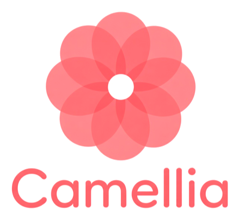

<p align="center">
  
</p>

<h3 align="center">Help the right clinician discover the right information early enough to act on it.</h3>

<p align="center">
  Clinical intelligence & care-coordination prototype · PalmettoHacks 2026 (Startup track) ·
  Google Gemini API · Snowflake
</p>

> **Demo application using synthetic patient information. Not for clinical use.**
> Camellia is a hackathon prototype. It is not HIPAA compliant, not clinically validated, not connected to Epic or any
> production EHR, and its user identities are simulated (role-based access is enforced by the backend, but anyone using
> the demo can pick any demo user). Never use it with real patient data.

---

## Contents

1. [Real-world inspiration](#real-world-inspiration)
2. [Problem statement](#problem-statement)
3. [Target users](#target-users)
4. [Core features](#core-features)
5. [Roles and access](#roles-and-access)
6. [Technology stack](#technology-stack)
7. [Architecture overview](#architecture-overview)
8. [Installation (Windows, macOS, Linux)](#installation)
9. [Environment configuration](#environment-configuration)
10. [Snowflake setup](#snowflake-setup)
11. [Gemini setup](#gemini-setup)
12. [Running the app](#running-the-app)
13. [Demo patient scenarios](#demo-patient-scenarios)
14. [Testing](#testing)
15. [Known limitations](#known-limitations)
16. [Future development](#future-development)
17. [Documentation map](#documentation-map)

---

## Real-world inspiration

Camellia started with a conversation with the Chief CRNA associated with Dominion Anesthesia in Arlington, Virginia.
They described how members of anesthesia departments take on coordination work on top of their clinical duties. One part
of that work is identifying obstetric patients whose medical conditions could complicate future anesthesia care.

In the workflow they described, information about these patients often arrives through individual provider messages.
Someone then adds it by hand to spreadsheets, shared files, or an EHR watchlist. The conversation also referenced
anesthesia workflows involving Kaiser. This is the workflow described in our interview, not necessarily the documented
process of any particular organization. We do not assume that the organizations mentioned share practices or have formal
relationships.

The interview included one incident in particular. A pregnant patient had a serious medical condition that called for
advance planning across specialties, but the anesthesia team learned about it late, only when anesthesia services were
needed. The team then had to review the history quickly, contact the other providers, build a plan, and share that
plan with colleagues, including the clinician who would actually staff the encounter. The information existed in the
records. It just had not reached the right specialists early enough.

When we asked what would help, the clinician proposed a smart notification tool. It would search obstetric records,
detect documented conditions relevant to anesthesia (low platelets was their example), raise an **"Anesthesia OB
Alert"**, attach the supporting records, and support contacting the referring physician and planning care. It would be an
additional safeguard, not a replacement for existing communication or for clinical judgment.

## Problem statement

1. **Manual identification of high-risk patients.** Flagging depends on someone noticing a problem and remembering to
   tell the right team.
2. **Fragmented information.** Histories are spread across organizations, EHR formats, notes, lab feeds and schedules,
   and searching them by hand is slow.
3. **Communication gaps between specialties.** A concern may be documented by obstetrics, maternal-fetal medicine (MFM),
   cardiology, oncology or hematology, while the team responsible for the upcoming encounter never sees it.

## Target users

- **Primary:** obstetric anesthesia care coordinators, for example a Chief CRNA or an obstetric anesthesiologist.
- **Secondary:** other authorized clinicians (MFM, labor & delivery, primary care reviewers) who need cross-organization
  record search and pattern review.

## Core features

| | Feature | What it does |
|---|---|---|
| **C** | **Anesthesia OB Alerts** *(primary workflow; L&D nurses, CRNAs, anesthesiologists)* | Finds obstetric patients with a **booked delivery-related encounter** and documented findings relevant to anesthesia planning (platelets below the lab's reference range, relevant conditions, anticoagulants, prior anesthesia complications). It creates an explainable flag and routes an in-app alert to the *Anesthesia OB Coordination* team. The review workspace covers evidence, Gemini Q&A, acknowledgement, notes, provider contact, planning status and the workflow New → Under Review → Coordination Needed → Plan Documented → Resolved (plus Dismissed with a reason). A **Coordination board** tab shows every alert by status with a shared planning summary. |
| **B** | **Clinical Alerts** *(proactive flags)* | Four deterministic, configurable rules: OB anesthesia review, recurrent fractures, repeated out-of-range labs, and repeated encounters for the same symptom. Every alert cites its source records. Re-running analysis never duplicates an alert. Changed evidence updates the existing flag and alert. A filter bar (text, category, status, priority, specialty) runs **server-side flag search**, and Clinical Search answers questions such as *"Find all patients flagged for low platelets."* |
| **A** | **Intelligent record search** | Natural-language search across all organizations the user may access. Gemini turns the request into **allow-listed structured criteria**, the backend runs **parameterized SQL**, and Gemini summarizes the results with citations. A keyword mode with filters (patient, organization, record type, dates) is also available. |
| ✦ | **Gemini clinical assistant** | Multi-turn chat on patient profiles, flags, alerts and search results. Each answer separates *documented facts*, *AI interpretation* and *missing information*. Every citation is checked against the records that were actually retrieved, and fabricated ones are removed. |
| ✦ | **Clinical document interpretation** | Gemini extracts structured observations from notes. An observation is stored only if it quotes its source record verbatim. |
| ✦ | **Source verification** | Every citation opens the original record, showing normalized content, source organization and system, and the raw HL7/FHIR/legacy/text payload exactly as received. |

## Roles and access

Camellia ships with six **simulated demo users**. Pick one from the user switcher in the top-right corner; switching is
one click and resets everything cached in the browser. The backend enforces every rule below on every endpoint, including
search, dashboards and Gemini retrieval, so a restricted record is never read, shown or sent to Gemini.

| Demo user | Role | Patients visible | Anesthesia OB Alerts | Can change alert review status | Coordination |
|---|---|---|---|---|---|
| Dr. Alex Kim | Physician (Internal Medicine) | **Practice A only**: Caleb, Dolores, Elias, Frances, Henry | — | ✓ | — |
| Dr. Sarah Mitchell | Physician (OB/GYN) | **Practice B only**: Ava, Beatriz, Grace, Imani | — | ✓ | — |
| Jordan Lee, RN | Registered Nurse | All 9 | — | — | — |
| Taylor Morgan, RN | Labor & Delivery Nurse | All 9 | ✓ view | — | Add notes |
| Maya Ellison, CRNA *(default)* | Nurse Anesthetist | All 9 | ✓ | ✓ | Full (acknowledge, status, contact, notes) |
| Dr. Daniel Brooks | Anesthesiologist | All 9 | ✓ | ✓ | Full |

- **Navigation follows the role.** Everyone sees Dashboard, Patients, Clinical Search and Clinical Alerts. Only L&D
  nurses, CRNAs and anesthesiologists see **Anesthesia OB Alerts** (work queue + coordination board).
- **Anesthesia OB data is part of the restricted workflow.** Flags from the OB anesthesia rule and all coordination
  alerts are hidden from other roles everywhere: lists, search, dashboards, patient profiles and Gemini context. Dr.
  Mitchell sees Ava's records (Ava is her patient) but not Ava's anesthesia alert.
- **Denials are generic.** A restricted or non-existent patient, record, flag or alert returns the same
  `403 ACCESS_DENIED`, so the response never confirms that a patient exists.
- **Practices** are stored in two small tables (`PRACTICES`, `PATIENT_PRACTICE_ASSOCIATIONS`). Practice A is Larkspur
  Regional Primary Care; Practice B is Bellwether Women's Health Associates.
- **Identity is simulated, not authenticated.** Choosing a user calls `POST /api/session`, which sets an HMAC-signed,
  HttpOnly session cookie. The backend trusts only that signed cookie, never a user id sent by the client. Anyone using
  the demo can still pick any user. That is the point of the demo, and it is not a security boundary.

## Technology stack

| Layer | Technology |
|---|---|
| Backend | Java 21, Spring Boot 4.1, Maven (wrapper included), Spring JDBC |
| Database | **Snowflake** via the official Snowflake JDBC driver 4.4 (key-pair auth). A clearly labeled H2 local fallback is used only when Snowflake isn't configured. |
| AI | **Google Gemini** via the official Google Gen AI Java SDK (`com.google.genai:google-genai` 1.76), default model `gemini-3.8-flash`, structured JSON output |
| Frontend | React 19, TypeScript, Vite 8, Tailwind CSS 4, Lucide icons, TanStack Query, React Router |
| Tests | JUnit 5, Spring Boot Test, MockMvc, AssertJ |

## Architecture overview

```
 Synthetic source systems (fictional)                 Spring Boot backend (Java 21)                       React frontend
┌──────────────────────────────────┐   ┌─────────────────────────────────────────────────────────┐   ┌──────────────────┐
│ Larkspur Regional   FHIR-like JSON│   │ ingestion/   normalizers → CLINICAL_RECORDS + typed rows │   │ Dashboard         │
│ Bellwether OB/MFM   legacy JSON   │──▶│ analysis/    4 explainable rules → flags → OB alerts     │   │ Patients/Profile  │
│ Northgate Labs      HL7 v2 ORU    │   │ coordination/ status workflow and notes                  │◀─▶│ Clinical Search   │
│ Cedar Hollow        FHIR-like JSON│   │ search/      NL → allow-listed criteria → param. SQL     │REST│ Clinical Alerts   │
│ Riverbend UC        dictation text│   │ ai/          retrieval → Gemini → citation validation    │/api│ Anesthesia OB     │
└──────────────────────────────────┘   │ security/    demo sessions · role & practice scope       │   │  (queue + board)  │
                                       │ integration/ Snowflake JDBC · Google Gen AI SDK          │   └──────────────────┘
                                       └───────────────┬─────────────────────────┬───────────────┘
                                                       │ JDBC (key-pair)          │ HTTPS (server-side key)
                                                ┌──────▼──────┐            ┌──────▼──────┐
                                                │  Snowflake  │            │ Gemini API  │
                                                └─────────────┘            └─────────────┘
```

The backend is the only component that talks to Snowflake or Gemini. The browser never sees credentials. See
[ARCHITECTURE_DECISIONS.md](ARCHITECTURE_DECISIONS.md) for the reasoning behind each choice.

```
Camellia/
├── backend/                 Spring Boot API (mvnw / mvnw.cmd included)
│   └── src/main/
│       ├── java/com/camellia/{config,controller,dto,model,repository,service,security,
│       │                      ingestion,analysis,search,coordination,ai,integration,web}
│       └── resources/
│           ├── application.yml                 configuration + PROTOTYPE rule heuristics
│           ├── db/schema-snowflake.sql         canonical Snowflake DDL
│           └── seed/                           synthetic multi-format source files
├── frontend/                React + TypeScript + Vite
├── database/snowflake/      one-time Snowflake account setup script
├── assets/                  logo (transparent PNG, the original, and the script that converted it)
└── *.md                     documentation
```

## Installation

### Prerequisites

| Tool | Version | Check |
|---|---|---|
| Java JDK | **21 or newer** (tested with 25) | `java -version` |
| Node.js | **20.19+ or 22.12+** (LTS recommended; tested with 26) | `node -v` |
| Maven | *Not required.* Use the included `mvnw` / `mvnw.cmd` wrapper. | |
| Git, VS Code | any recent | |

On Windows, install the JDK (for example Microsoft Build of OpenJDK 21 or Eclipse Temurin 21) and make sure `JAVA_HOME` is
set. Install Node.js LTS from nodejs.org. Commands below are given for **PowerShell** and **Git Bash**.

### 1. Clone and install frontend dependencies

```powershell
# PowerShell
git clone <your-repo-url> Camellia
cd Camellia\frontend
npm install
```

```bash
# Git Bash / macOS / Linux
git clone <your-repo-url> Camellia
cd Camellia/frontend
npm install
```

The backend downloads its dependencies the first time you run `mvnw`.

## Environment configuration

Copy the template to **`backend/.env`**. This file is git-ignored.

```powershell
# PowerShell (from the repo root)
Copy-Item .env.example backend\.env
```

```bash
# Git Bash (from the repo root)
cp .env.example backend/.env
```

Then edit `backend/.env`. Never paste secrets into chat or commit them. The format is `KEY=value`, one per line, with no
quotes. **Use forward slashes in file paths, even on Windows** (for example `C:/Users/you/.snowflake/rsa_key.p8`).

| Variable | Purpose |
|---|---|
| `GEMINI_API_KEY` | Google AI Studio API key (server-side only) |
| `GEMINI_MODEL` | Default `gemini-3.8-flash` |
| `GEMINI_FALLBACK_MODEL` | Default `gemini-3.5-flash-lite`; used when the primary model is overloaded or rate limited |
| `GEMINI_THINKING_LEVEL` | Default `low`, for faster answers |
| `SNOWFLAKE_ACCOUNT` | Account identifier, `orgname-accountname` |
| `SNOWFLAKE_USER` | User with the registered RSA public key |
| `SNOWFLAKE_PRIVATE_KEY_FILE` | Path to the PKCS#8 `.p8` private key (keep it outside the repo) |
| `SNOWFLAKE_PRIVATE_KEY_PASSPHRASE` | Only if the key is encrypted |
| `SNOWFLAKE_WAREHOUSE` / `SNOWFLAKE_DATABASE` / `SNOWFLAKE_SCHEMA` / `SNOWFLAKE_ROLE` | Session context (defaults: `CAMELLIA_DEMO` / `CLINICAL`) |
| `SNOWFLAKE_CREATE_DATABASE` | `true` lets the app run `CREATE DATABASE/SCHEMA IF NOT EXISTS` |
| `CAMELLIA_DB_MODE` | `auto` (default), `snowflake` (require Snowflake) or `local` (labeled fallback only) |
| `CAMELLIA_DEMO_ANCHOR_DATE` | Optional fixed anchor for synthetic dates (`YYYY-MM-DD`) |
| `CAMELLIA_DEMO_SESSION_SECRET` | Optional (16+ characters). Signs demo-session cookies. If unset, a random secret is generated at startup, and the browser silently re-selects its demo user after a backend restart. |

With nothing configured, the app still runs. The UI shows **"Local fallback DB"** and **"Gemini not configured"**
badges, AI features show a labeled *retrieval-only* mode, and search uses a labeled rule-based interpreter. No simulated
AI text is ever produced.

## Snowflake setup

1. **Create a key pair** (Git Bash, macOS or Linux; OpenSSL ships with Git for Windows):
   ```bash
   mkdir -p ~/.snowflake
   openssl genrsa 2048 | openssl pkcs8 -topk8 -inform PEM -out ~/.snowflake/rsa_key.p8 -nocrypt
   openssl rsa -in ~/.snowflake/rsa_key.p8 -pubout -out ~/.snowflake/rsa_key.pub
   ```
2. **Run [`database/snowflake/00_account_setup.sql`](database/snowflake/00_account_setup.sql)** in a Snowsight
   worksheet. It creates the warehouse, database, schema and role, and registers the public key
   (`ALTER USER … SET RSA_PUBLIC_KEY='…'`). Paste the key body without the BEGIN/END lines.
3. **Fill in the `SNOWFLAKE_*` values** in `backend/.env`. The end of the setup script lists them: user
   `CAMELLIA_SVC`, role `CAMELLIA_APP`, `SNOWFLAKE_CREATE_DATABASE=false`, and the account identifier printed by its
   final `SELECT`. If the schema already exists, the backend uses it and does not need CREATE DATABASE privileges.
4. **Start the backend.** On startup it:
   - connects with `authenticator=SNOWFLAKE_JWT`;
   - runs [`schema-snowflake.sql`](backend/src/main/resources/db/schema-snowflake.sql) (`CREATE TABLE IF NOT EXISTS …`);
   - normalizes and **idempotently** seeds the synthetic dataset with batched inserts;
   - runs the screening engine.

   The log line `Camellia ready on Snowflake` confirms it. If the configuration is incomplete, startup stops with a
   message that lists exactly what is missing.
   The two practice tables are created and seeded the same way, so an existing Snowflake database is upgraded in place.
5. **Verify** in the app under **Demo & integrations → Run read / write check**, or with
   `curl -X POST http://localhost:8080/api/integrations/database/check`.

## Gemini setup

1. Create an API key at <https://aistudio.google.com/apikey>.
2. Put it in `backend/.env` as `GEMINI_API_KEY=…`. Optionally change `GEMINI_MODEL`.
3. Restart the backend. The header badge changes to **"Gemini live"**.
4. Verify under **Demo & integrations → Send live test request**. This makes a real API call and shows the model,
   latency, token counts and response.

## Running the app

Use two terminals.

**Terminal 1: backend** (http://localhost:8080)

```powershell
# PowerShell
cd backend
.\mvnw.cmd spring-boot:run
```
```bash
# Git Bash
cd backend
./mvnw spring-boot:run
```

**Terminal 2: frontend** (http://localhost:5173)

```bash
cd frontend
npm run dev
```

Open **http://localhost:5173**. The Vite dev server proxies `/api` to the backend.

Useful extras:

- `GET http://localhost:8080/api/integrations/status`: which database and AI mode is active
- **Demo & integrations → Reset demo data**: re-seeds with today as the date anchor. Run this before presenting so
  upcoming encounters are relative to the demo day.
- **Demo & integrations → Simulate incoming lab result**: a new HL7 platelet result for Patient A, used to demonstrate
  re-evaluation without duplicate alerts.

## Demo patient scenarios

All patients, organizations and providers are fictional. Dates are relative to the demo anchor date.

Practice A = Larkspur Regional Primary Care (Dr. Kim). Practice B = Bellwether Women's Health Associates (Dr. Mitchell).

| ID | Patient | Scenario | Expected behavior |
|---|---|---|---|
| A · CAM-P-1001 | **Ava Marlowe** | OB, induction in ~12 days; platelets 162 → 118 → 86 (lab ref 150–400); thrombocytopenia documented by OB | **Anesthesia OB alert** (expedited) |
| B · CAM-P-1002 | **Beatriz Okonkwo-Hale** | OB, cesarean in ~18 days; Hodgkin lymphoma treated with chemo and mediastinal radiation; anthracycline cardiomyopathy (LVEF 45%); enoxaparin; MFM, cardiology and oncology involved | **Multidisciplinary coordination alert** |
| I · CAM-P-1009 | **Imani Brooks** | OB, repeat cesarean in ~47 days; spinal fusion; failed labor epidural at a *different* hospital | **Anesthesia OB alert**: the key history lives at another organization |
| C · CAM-P-1003 | **Caleb Wren** | 4 fracture encounters at 3 organizations; COPD with steroid courses; low vitamin D | **Recurrent fracture flag**; cross-organization search |
| D · CAM-P-1004 | **Dolores Fenwick** | Serum calcium above range 4 times from 2 organizations; planned PTH never resulted | **Repeated abnormal lab flag** |
| E · CAM-P-1005 | **Elias Navarro** | 5 headache encounters (urgent care, ED and primary care) in a year | **Repeated symptom flag** |
| F · CAM-P-1006 | **Frances Albright** | Diabetes, hypothyroidism, CKD 2, OSA, many medications and notes | Searchable, **no flags** |
| G · CAM-P-1007 | **Grace Thornbury** | Routine pregnancy with normal labs; tentative induction slot | In OB directory, **no alert** |
| H · CAM-P-1008 | **Henry Castellan** | Minimal routine history | Normal profile and search, **no flags** |

## Testing

```powershell
cd backend
.\mvnw.cmd test        # Git Bash: ./mvnw test
```

51 tests cover patient retrieval, search filtering and SQL safety, the screening rules, alert generation, duplicate
prevention, re-evaluation, status persistence and transition rules, evidence and citation validation, AI response
parsing, Gemini grounding (with a scripted gateway), missing Gemini configuration, missing or partial Snowflake
configuration, and multi-format normalization.

`RoleBasedAccessIntegrationTest` (12 tests) covers role-based access end to end: practice-scoped patient lists, generic
403s for restricted and missing ids, the anesthesia workflow restriction, coordination permissions per role, flag search
scoping, per-user dashboards, missing and tampered sessions, and proof that **no Gemini request is made** for a denied
context and that Gemini prompts never contain patients outside the user's scope.

```bash
cd frontend
npm run build          # type-check + production build
```

## Known limitations

- **Prototype rules.** The screening rules are narrow keyword and threshold heuristics on synthetic data, not
  validated clinical logic or risk prediction. The thresholds in `application.yml` are labeled as prototype heuristics.
- **Simulated identity.** There is no real authentication. Anyone can switch to any demo user. The signed session
  cookie only stops the browser from asserting an arbitrary identity per request. Access rules are enforced server-side
  but are a demonstration, not a reviewed security model.
- **Simplified access model.** Nurses and anesthesia roles see every synthetic patient (a prototype simplification;
  real access would depend on care relationships and organization policy). There is no break-the-glass flow, and the
  activity log is not an audit-grade access log.
- **No real integrations.** No connection to Epic or any production EHR, and no real notifications. Alerts exist only in
  the in-app queue.
- **Synthetic data only.** Not HIPAA compliant. Gemini receives synthetic records over the public API.
- **Conversation memory** for the assistant is in memory on the server (2-hour TTL) and is not persisted. Flag
  explanations and AI observations *are* persisted.
- **Snowflake uniqueness** is enforced by the application. Snowflake primary keys are informational, and the backend
  assumes a single instance.
- **Search** uses keyword and concept matching (no semantic or vector search yet).

## Future development

- SMART on FHIR / HL7 interfaces to real EHR sandboxes, and an identity-matching (MPI) service.
- Real authentication (SSO/OIDC), care-relationship-based access, audit trails and a BAA-covered AI deployment (e.g. Vertex AI).
- Snowflake Cortex Search or vector embeddings for semantic retrieval. Snowflake streams and tasks for continuous
  screening as new records arrive.
- More specialty workflows (cardio-obstetrics, oncology pre-procedure review, pediatric anesthesia), each with
  clinician-authored, validated criteria.
- Secure messaging integration for contacting referring providers, with escalation and SLA tracking.

## Documentation map

| File | For |
|---|---|
| [USER_GUIDE.md](USER_GUIDE.md) | Walkthrough of every screen and action |
| [DEMO_SCRIPT.md](DEMO_SCRIPT.md) | Live hackathon presentation script |
| [ARCHITECTURE_DECISIONS.md](ARCHITECTURE_DECISIONS.md) | Why things are built the way they are |
| [IMPLEMENTATION_STATUS.md](IMPLEMENTATION_STATUS.md) | What is done, tested or blocked |
